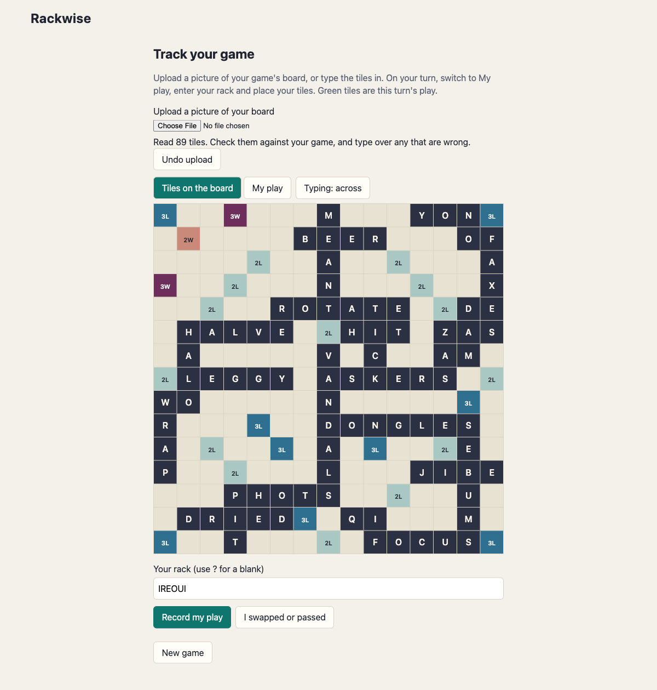
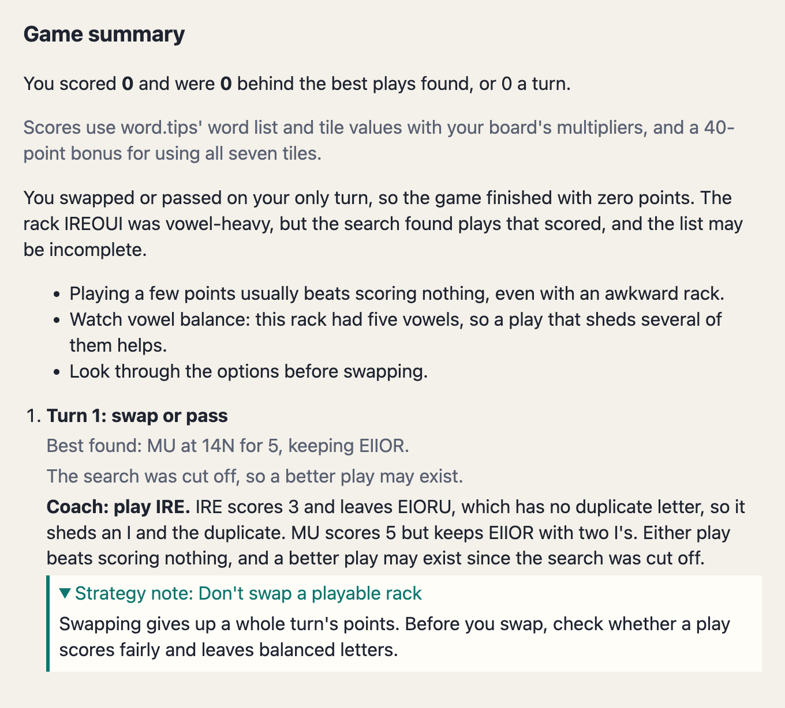

# Rackwise

An AI coach for crossword word games. Track your plays on a board as you go, and get a coaching summary when the game is over.

> **Status:** tracking, picture reading, turn reviews and end-of-game coaching all work, and the coach cites strategy notes chosen for each mistake. The robot opponent has been removed from the app, and its code is still in the repo.

## Setup

You need Docker. Then run:

```sh
docker compose up --build
```

Every setting has a default. To override one, copy `.env.example` to `.env` and edit it.

| Service | URL |
|---|---|
| The coach | http://localhost:5173 |
| Engine health check | http://localhost:8080/healthz |
| Coach health check | http://localhost:8000/healthz |

## Using it on your phone

This is off by default. Add `WEB_HOST=0.0.0.0` to `.env` and run `docker compose up -d web`. Find your computer's address with `ipconfig getifaddr en0` on a Mac, then open `http://THAT_ADDRESS:5173` on a phone on the same Wi-Fi. **Upload a picture** then offers your photo library.

There is no login, so anyone on that network could use the app and your API key. Only do this on a network you trust. Only the web page is exposed, and the other services stay on your computer.

## Demo

**1. Upload a picture of your board.** Claude reads the tiles and your rack onto the grid, and you check them and type over any mistakes. Here it read all 89 tiles from a picture of a finished game.



**2. Record your turns, then finish the game.** Plain code finds the best plays with word.tips and compares them with yours. Then one Claude call writes the summary, and cites a strategy note for each mistake. Here the only turn recorded was a pass with IREOUI, so the coach points to the plays that scored.



The coaching above came from a real call and cost under one cent.

## Architecture

_Diagram to come._

- `engine/`: Go game engine, bots and saved games. Not used by the app since the bots were removed. See its [API](docs/engine-api.md).
- `coach/`: Python coach service, and later the MCP server.
- `web/`: React and TypeScript frontend.
- `db/`: Postgres with pgvector.

## How the coach works

Upload a picture of your game's board, or type the tiles onto the grid. Claude reads the picture, so uploading needs `ANTHROPIC_API_KEY` too, and you should check the result. On your turn, enter your rack, switch to **My play** and place your tiles. Recording a turn shows every word formed, such as `ES, AE, TS`, and its score. When the game is over, choose **Finish game and get coaching**. To get coaching, set `ANTHROPIC_API_KEY` in `.env`. Without it, the turn review still works.

At the end of the game:

1. word.tips checks every word you formed, and lists the words your rack could make with each row and column.
2. Plain code fits those words onto real squares, checks their cross-words, and scores each play with the board's multipliers.
3. Plain code compares your play with the top 5 on each turn, and adds up the game.
4. Plain code tags each turn's problems, such as a kept duplicate or a missed seven-tile play. For each problem, the closest [strategy note](notes/) with that tag is found in pgvector. See [the decision record](docs/decisions/0010-strategy-retrieval.md).
5. Claude writes one summary of the whole game using a [versioned prompt](prompts/coach/game-v3.md), and cites the notes that fit. You see each cited note in full beside the advice.
6. A check withholds any answer that mentions a word, position or number outside the data, or cites a note that wasn't sent.

The LLM never decides whether a word is valid or what it scores. Here, word.tips decides validity and supplied the tile values, and code applies the board's multipliers. The coach can't judge defence, because the data doesn't show what a play opens. A review makes up to 12 requests to word.tips per turn, so a 15-turn game can take about 3 minutes. See [the decision record](docs/decisions/0008-practice-coach.md).

## Known limits

- The best play means the highest score found, weighed by the coach against the tiles you keep. Nothing simulates future turns, so a stronger engine will sometimes disagree.
- The search can miss plays, including high-multiplier ones: word.tips shows its top 30 words per length regardless of the board, and lookups are capped. The result says when this happens.
- The 40-point bonus for using all seven tiles comes from third-party guides, and multipliers are assumed to count only for newly placed tiles.
- Blanks already on the board count as normal letters.
- Reading a picture of a very full board can fail: on the board shown above, it worked once in three tries. The other two returned rows of the wrong length, which the app refuses, and each try costs about four cents.
- Words come from word.tips' NWL23 list, which may differ from the list your game uses.
- There are no accounts, and games are kept in your browser, so this is meant to run locally.
- Strategy notes are general advice for this kind of game, written for this project. Which notes fit a turn is decided by fixed rules, such as a play 6 or more points behind the best, that haven't been tuned on real games.
- The embedding model runs on your machine. Loading it makes one metadata request to huggingface.co per coach start, and no game data is sent.

## Eval results

The [eval set](evals/README.md) has 17 cases: 15 single turns and 2 whole games. Each is graded on its recommendation, what it must and mustn't mention, and the check that withholds anything outside the data. Results are in `evals/results/`.

| Prompt | Passed | Cost of the run |
|---|---|---|
| `game-v1` | 12 of 17 | $0.117 |
| `game-v2` (current) | 16 of 17 | $0.122 |

Between the two runs, the grader and test data were also corrected:
- An answer with no recommendation now counts as backing the player's own best play, which is what the prompt asks for.
- A leave with no vowels also counts as mentioning consonants.
- The rack written without its blank is allowed.
- Hand-written cases now include the bonus for using all seven tiles.

The prompt change made Claude say when a better play may exist because the search was cut off. In the one remaining failure, the answer was withheld because Claude wrote the word endings "ED" and "ING" in capitals. The check worked as intended there, and the player still gets the turn review.

Costs are measured on Sonnet 5.5 list prices. A one-turn eval game used about 2,300 input and 250 output tokens, so about $0.007. A picture read used 2,393 input and 3,141 output tokens, so $0.036. A full 15-turn summary hasn't been measured yet, but should be a few cents.

The grader matches text, so it can't judge how good the advice is. The cases use hand-written word lists.

### Strategy notes and input size

Phase 5 added strategy notes and trimmed what's sent to Claude. Input tokens, from the free token counter:

| Input | Before (game-v2) | After (game-v3) |
|---|---|---|
| A 15-turn game shaped like real review output | 18,908 | 13,220 |
| The 17 eval cases together | 30,813 | 32,934 |

On a full game the trimming saves more than the notes add. On the small eval cases the longer prompt outweighs it. Sending all 50 notes instead of retrieving would add 5,792 tokens to every game. `score.py --check` also grades retrieval: 12 cases name the notes that must be sent, and all pass. The paid eval runs for game-v3 haven't been done yet.

## Development

```sh
(cd engine && go test ./...)

cd coach && python3 -m venv .venv && source .venv/bin/activate
pip install -e ".[dev]" && pytest && ruff check .

cd web && npm install && npm test && npm run lint && npm run typecheck
```

## Word lookup tool

`.mcp.json` connects Claude Code to `lookup_words`, a practice tool that lists words and their points from word.tips for a rack and board letters. It needs the coach's virtual environment from the steps above. See [the decision record](docs/decisions/0007-word-additions.md) for its limits and risks.

## Licence

MIT. See [LICENSE](LICENSE). Reused material is listed in [THIRD_PARTY.md](THIRD_PARTY.md).
